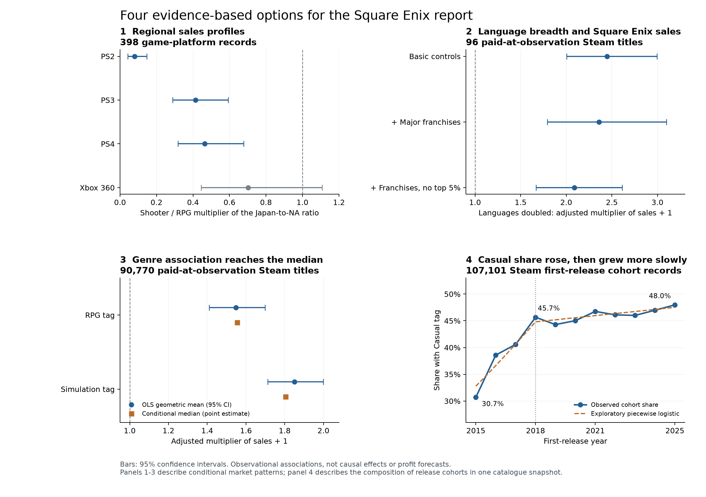

# Square Enix: Four Data-Supported Findings

An exploratory analysis for our CAES9821 group discussion. The aim is to compare four possible findings and select three that best complement the group's report.

**Start here:** [Findings](#findings-in-detail) · [Methods](#analysis-methodology) · [Download the complete analysis](complete-analysis.zip) · [Chart PDF](four_trend_options.pdf)

The full, structured project is in **[complete-analysis.zip](complete-analysis.zip)**: all Python scripts, model summaries, coefficient tables, JSON results, figures, dependencies and data instructions. The explanations below are readable directly on GitHub.

## The four options

| Finding | Data source | Analysis method |
|---|---|---|
| **1. Regional positioning:** Historical PlayStation RPG sales were relatively more Japan-oriented than shooter sales. | Course VGChartz workbook; 398 game–platform records from 2000–2018. | Multiple regression of the log Japan-to-North-America sales ratio, with controls and a genre-by-console interaction. |
| **2. Language support:** Square Enix Steam titles supporting more languages generally had higher estimated sales, including after major-franchise controls. | Course Gamalytic/Steam workbook; 96 Square Enix titles from 2015–2025. | Multiple regression of log sales, with price, score, release-year, genre and franchise controls. |
| **3. Genre patterns beyond blockbusters:** Positive RPG and simulation sales associations also appeared at the conditional median. | Gamalytic/Steam workbook; 90,770 paid-at-observation titles from 2015–2025. | Multiple regression and median regression, plus checks excluding top-selling titles. |
| **4. Changing release mix:** Casual titles had a higher share in later Steam release cohorts, with most growth early in the period. | Gamalytic/Steam workbook; 107,101 titles from 2015–2025. | Annual comparisons and an exploratory piecewise logistic regression. |

These are observed associations, **not estimates of causal sales gains or profitability**. The fourth finding describes the composition of a catalogue snapshot by first-release year, not consumer demand. Genre tags can overlap.



## How the analysis was done

1. Read the teacher-provided Excel workbooks and record their SHA-256 fingerprints.
2. Define a sample appropriate to each question; handle duplicates, missing fields and overlapping tags explicitly.
3. Fit interpretable regression models, with log sales or log regional ratios where appropriate.
4. Check the specific alternative explanation relevant to each finding: small rounded regional sales, franchise composition, blockbusters, or free-title/publisher composition.
5. Save model summaries, coefficients, confidence intervals and figures, and distinguish what the evidence supports from what it cannot establish.

See [methodology.md](complete-analysis.zip) for the exact filters, formulas and inference choices. The methods were exploratory; no claim of preregistration is made.

## Reproduce the analysis

Raw course data are not redistributed. Group members can use their own copies of the two workbooks. See [data/README.md](complete-analysis.zip) for exact filenames and checksums.

Download and extract **complete-analysis.zip** first. Tested with Python 3.12.14. From the extracted project folder:

```bash
python3 -m venv .venv
source .venv/bin/activate
python -m pip install -r requirements.txt
# Put the two course Excel workbooks in data/ first.
python scripts/run_all.py
```

The run regenerates the four sets of results and figures. It also writes row-level audit files locally; these and the workbooks are ignored by Git. Published files are the code, explanations, aggregate results and figures.

## Repository guide

```text
docs/            Plain-English findings and detailed methodology
scripts/         Portable analysis and chart-generation scripts
results/         Aggregate results, model summaries and coefficient tables
figures/         PNG and PDF figures
data/README.md   How to supply the original course data locally
requirements.txt
```

- [Regional results](complete-analysis.zip)
- [Square Enix language-support results](complete-analysis.zip)
- [Steam genre results](complete-analysis.zip)
- [Release-cohort results](complete-analysis.zip)

## Scope and limitations

This repository documents an analysis of the supplied course snapshots, prepared on **5 October 2026**. Steam sales are vendor estimates of cumulative sales. Prices, language support, review scores and tags reflect the supplied snapshot and may differ from their release-time values. Budgets, marketing and IP strength are not fully observed; model confidence intervals do not include source coverage or vendor estimation error.

The supplied mobile workbook is a selected high-revenue sample and is not used to make general mobile-market claims here. No raw course materials or personal local paths are included in the publication.


## Findings in detail

# Four candidate findings

These are four options for the group's Square Enix consultancy report. The first three describe market patterns; the fourth describes change across release years. All findings are observational associations, not proof that a business decision would cause a particular sales increase.

## Quick list for the group

1. **Different genres have different regional sales patterns.** RPGs had a more Japan-oriented sales profile than shooters in the historical PlayStation sample. **Source:** teacher-provided VGChartz workbook, 398 game–platform records from 2000–2018. **Method:** multiple linear regression of the log Japan-to-North-America sales ratio, with a genre-by-console interaction.
2. **Broader language support is associated with higher Square Enix sales.** The relationship remained after accounting for major franchises. **Source:** teacher-provided Gamalytic/Steam workbook, 96 Square Enix titles first released in 2015–2025. **Method:** multiple linear regression, with franchise controls and checks excluding top sellers.
3. **RPG and simulation sales patterns extend beyond blockbusters.** Positive associations also appeared around the middle of the conditional sales distribution. **Source:** Gamalytic/Steam workbook, 90,770 paid-at-observation titles first released in 2015–2025. **Method:** multiple linear regression and median regression, plus a check excluding the top 1% of sellers.
4. **Casual games gained release share, but growth slowed.** Most of the increase occurred during 2015–2018, followed by smaller gains. **Source:** Gamalytic/Steam workbook, 107,101 titles first released in 2015–2025. **Method:** annual comparisons and exploratory piecewise logistic regression.

The original filenames, worksheets and checksums are documented in [data instructions](complete-analysis.zip). The [methodology](#analysis-methodology) explains the filtering, models and uncertainty. An [overview figure](four_trend_options.png) compares the four options.

## 1. Regional positioning: the genre difference varies by console

We compared RPGs and shooters with positive recorded sales in both Japan and North America. The regression controlled for release year, critic score and publisher and allowed the genre difference to vary across consoles.

| Console | Adjusted ratio multiplier: shooter relative to RPG | 95% confidence interval |
|---|---:|---:|
| PS2 | 0.079 | 0.043–0.147 |
| PS3 | **0.414** | **0.289–0.593** |
| PS4 | **0.464** | **0.318–0.678** |
| Xbox 360 | 0.702 | 0.445–1.107 |

For example, the model estimates that a shooter's Japan/NA sales ratio on PS3 was about 41% of the ratio for an RPG with the same control-variable values. This compares the two genres' regional sales profiles; it does not say that an RPG necessarily sold more copies in Japan than in North America.

The PS3 and PS4 multipliers remained below one, at **0.531 and 0.540**, after excluding records with fewer than 50,000 copies in either region to reduce sensitivity to rounding. The Xbox 360 estimate was inconclusive.

**Use for Square Enix:** evaluate regional positioning by genre and platform rather than relying only on worldwide genre rankings. **Boundary:** this is a selective historical sample, not evidence about all games, individual consumer preferences or current consoles.

[Detailed results](complete-analysis.zip)

## 2. Localisation: the association survives major-franchise controls

Among 96 Square Enix titles, a doubling of supported languages was associated with a **2.45-fold conditional geometric mean of sales plus one** after controlling for price, review score, release year and major genre tags.

| Specification | Titles | Multiplier for doubling language count | 95% confidence interval |
|---|---:|---:|---:|
| Basic controls | 96 | 2.45 | 2.00–2.99 |
| Add major-franchise controls | 96 | **2.36** | **1.79–3.10** |
| Franchise controls, excluding the highest-selling 5% | 91 | 2.09 | 1.67–2.61 |
| Franchise controls, excluding 2025 releases | 91 | 2.40 | 1.81–3.18 |

**Use for Square Enix:** make language coverage an explicit part of distribution planning, then assess individual languages against expected demand and localisation costs. **Boundary:** the model does not establish a causal return from adding languages. Budgets, expected popularity and post-success language updates may influence both language coverage and sales. The data cannot identify which countries account for the additional sales.

[Detailed results](complete-analysis.zip)

## 3. Genre opportunities: the pattern is also present at the median

The models controlled for price, language coverage, review score, release year, early-access status and overlapping genre tags.

| Adjusted sales-plus-one measure | RPG tag | Simulation tag |
|---|---:|---:|
| Conditional geometric mean multiplier | **1.548** | **1.850** |
| 95% CI, publisher-list clustered | 1.410–1.698 | 1.712–2.000 |
| Conditional median multiplier | **1.555** | **1.805** |
| Geometric mean multiplier after excluding the top 1% of sellers | 1.522 | 1.824 |

Each multiplier compares titles with a tag against those without that tag, holding the model's other variables constant. The median results and trimmed-sample check suggest that the associations are not explained solely by a handful of blockbusters.

**Use for Square Enix:** provide a PC-market reason to investigate RPG and simulation opportunities further. **Boundary:** these tags overlap, so this is not a direct ranking of two mutually exclusive categories. It does not show that adding simulation mechanics to an RPG increases sales. Development costs, profitability and project failure risk were not measured.

[Detailed results](complete-analysis.zip)

## 4. Release composition: Casual rose early, then grew more slowly

The observed Casual share was **30.7% in the 2015 release cohort, 45.7% in 2018 and 48.0% in 2025**. An exploratory model allowed different slopes before and after 2018.

| Period | Model-fitted Casual share | Fitted change | 95% CI for change |
|---|---:|---:|---:|
| 2015–2018 | 32.8% → 44.8% | **+12.02 percentage points** | +9.31 to +14.73 |
| 2018–2025 | 44.8% → 47.5% | **+2.71 percentage points** | +0.55 to +4.86 |

The fitted shares differ from the raw observations above. A broader comparison of 2015–2019 against 2020–2025 also remained positive when restricted to paid titles or when Hobbyist-class publishers were excluded.

**Use for Square Enix:** assess competition and differentiation when considering a Casual offering. **Boundary:** this describes the composition of one observed catalogue by first-release year. It does not establish growing consumer demand, profitability or a historical census of every game available each year. The 2018 split was selected after inspecting the annual pattern and is exploratory.

[Detailed results](complete-analysis.zip) · [Annual counts and shares](complete-analysis.zip)

## Choosing three

Keep **2 and 3** if the report should emphasise sales and practical product/distribution decisions. Add **1** for a console and regional perspective, or **4** for a clear time trend and supply-side perspective. If another group member already covers regional analysis, **2 + 3 + 4** avoids repeating the same question.

The third teacher-provided workbook, *Mobile Games*, was not used for these four findings. Its selected high-revenue games are unsuitable for treating the sample as representative of the full mobile market.


## Analysis methodology

# Methodology and interpretation

This document describes the analysis behind the [four candidate findings](#findings-in-detail). It separates what was measured, how each model was fitted, and what its results can support. These are exploratory analyses for a consultancy report, not causal experiments or validated sales forecasts.

## Data and common decisions

Two teacher-provided workbooks were analysed:

| Source | Worksheet | Original rows | Used for |
|---|---|---:|---|
| `1 - PC Console VGCHARTZ Data 2024.xlsx` | `vgchartz-2024-ordered` | 64,016 | Regional sales profiles |
| `2 - PC Gamalytic Scraped.xlsx` | `GameAnalytics` | 121,942 | Localisation, genre associations and release composition |

Raw workbooks are not distributed in this repository. See [data instructions](complete-analysis.zip) for placement and checksum information. Analysis reads the originals without modifying them. The results describe those supplied snapshots, not a live extract from either provider.

For the Steam analyses, a title had to be marked released, have a first-release year in **2015–2025**, and have at least one of ten common game tags: Action, Adventure, Casual, Indie, RPG, Racing, Simulation, Sports, Strategy or Massively Multiplayer. This excludes obvious non-game catalogue entries. Eligible records had no duplicate Steam IDs. Genre tags overlap and are represented by separate indicators.

The paid sales sample additionally required a positive observed price, no case-insensitive `Free to Play` tag and at least one supported language. This produced **90,770 titles**. “Paid” therefore refers to the observed snapshot, not every price charged throughout a game's life. The composition analysis includes free and paid titles and uses **107,101 titles**. Incomplete 2026 release cohorts were excluded.

Sales models use `ln(copiesSold + 1)`: sales are strongly skewed and adding one retains the six zero-sales titles in the large paid sample. Exponentiating an OLS coefficient describes a **conditional geometric-mean multiplier of sales plus one**, not an arithmetic-mean sales multiplier. For median regression, the monotonic transformation gives a **conditional median multiplier of sales plus one**. All reported confidence intervals are model-based and exclude errors in the provider's sales estimates and coverage.

## 1. Regional sales profiles

**Question:** does the Japan-to-North-America sales profile differ between RPGs and shooters, and does the difference vary by console?

### Selection and preparation

- Keep releases from 2000–2018 and the two selected genres.
- Exclude all rows with duplicated title–console keys rather than selecting an arbitrary duplicate.
- Require positive recorded sales in both regions; missing sales are not treated as zero.
- Require at least ten records from each genre on a console. PS2, PS3, PS4 and Xbox 360 meet this rule.

The final sample contains **398 game–platform records, 308 unique titles**, including 174 RPG and 224 shooter records. Of 6,516 nonduplicate two-genre records in the date window, only 635 had positive sales in both regions before the console-support restriction. This is an important selection limit.

The 164 missing critic scores were filled with the sample median, 7.8, and accompanied by a missing-score indicator. Publishers with at least ten records were represented individually; the remainder formed an Other category.

### Model and inference

```text
ln(Japan sales / North America sales)
    ~ Shooter * Console
    + Release-year categories
    + Critic score + Missing-score indicator
    + Publisher group
```

The `*` includes genre, console and their interaction. Standard errors are clustered by title, allowing records of the same game on different platforms to be related. A joint interaction test gave F(3,307) = 11.97, p < .001, so console-specific contrasts are reported rather than imposing one common genre difference. Holm adjustment was applied to the four console comparisons; the confidence intervals displayed in the findings are individual, not simultaneous, intervals.

Exponentiated contrasts compare the adjusted geometric means of the JP/NA ratio for shooters and RPGs. A multiplier below one indicates a relatively more North-America-oriented shooter profile. It does not measure an absolute sales decline or individual preferences.

### Checks

The interaction model was refitted after requiring at least 0.05 million copies in each region, reducing rounding sensitivity and leaving 184 records. Additional checks used only PS3/PS4 records or only records with observed scores. The PlayStation direction persisted. Missing regional coverage, unmeasured IP strength and budgets, and the historical sample limit generalisation.

[Results and model formulae](complete-analysis.zip)

## 2. Language coverage and Square Enix sales

**Question:** is the language–sales association visible within Square Enix, including after limited controls for major franchises?

The paid Steam sample was restricted to titles whose publisher field included Square Enix, leaving **96 titles**. Publisher ownership is taken from the course snapshot. Unique supported language names were counted; duplicate language-list entries were checked. The measure captures breadth, not translation quality or full-audio coverage.

### Model

```text
ln(copiesSold + 1)
    ~ log2(Language count) + log2(Observed price)
    + Review score / 10 + Linear release year
    + Action + Adventure + RPG
```

These three tags had sufficient presence and absence in the small company sample. A linear year term limits the number of parameters: eight in the baseline model, including the intercept. HC3 heteroskedasticity-robust standard errors were used. A one-unit increase in `log2(Language count)` corresponds to doubling the count.

A second model added four franchise groups, identified from title keywords: Final Fantasy (22), Dragon Quest (10), SaGa (8) and Other (56). This gave eleven parameters. The coding is a targeted check and does not capture every franchise or measure IP strength fully.

### Checks and scope

The franchise-adjusted model was refitted excluding 2025 releases and excluding the top 5% by sales; each left 91 titles. A further model excluded Final Fantasy and SaGa entirely, leaving 66. The positive association remained in all checks.

Language coverage, prices and reviews are observed after release. Successful games may receive later language updates, and budget, expected demand or marketing may influence both language count and sales. The coefficient must not be described as the causal sales gain from adding languages. No regional sales are available to identify which language or country drives the association.

The published finding relies on the company-specific models. Any earlier full-market localisation estimates retained in historical output are supporting provenance, not needed for this claim.

[Company model results](complete-analysis.zip)

## 3. Genre associations beyond blockbusters

**Question:** do RPG and simulation associations extend to the conditional median, and do they survive removal of the largest sellers?

The **90,770-title** paid sample contains 16,930 RPG-tagged titles and 20,147 simulation-tagged titles; 3,893 have both tags. Eight thousand and two titles have a zero review score. A zero-score indicator is used because the meaning of zero may differ from an ordinary low score.

OLS and median regression use the same predictors:

```text
ln(copiesSold + 1)
    ~ log2(Observed price) + log2(Language count)
    + Review score / 10 + Zero-score indicator
    + Early-access indicator + Release-year categories
    + Ten overlapping genre indicators
```

OLS inference is clustered by the identical publisher list, with **50,401 groups**. Empty publisher lists are grouped by individual Steam ID. This allows correlation within a recorded list, but does not identify every shared publisher across differently written or partly overlapping lists.

Median regression estimates the middle of the conditional distribution directly; it does not select a subset of “middle-selling” games. Its standard errors are heteroskedasticity-robust asymptotic estimates and **are not publisher-clustered**. Accordingly, the overview emphasises median point estimates and clustered OLS intervals. The median fit converged after 268 iterations without a convergence warning.

Benjamini–Hochberg adjustment across ten genre tests retained the RPG and simulation associations. OLS was repeated after removing the highest-selling 1% (89,862 titles retained) and after excluding zero-score titles (82,768 retained).

The combined checks address sensitivity to extreme sellers, but do not establish lower failure risk or higher profits. Separate tag coefficients are not a direct comparison of exclusive genres, and no RPG-by-Simulation interaction was tested. Release-year categories only partly account for differences in time available to accumulate sales.

[Model results and coefficients](complete-analysis.zip)

## 4. Casual release composition over time

**Question:** how does the proportion of Casual-tagged titles vary across first-release cohorts?

This analysis includes **107,101 free and paid titles**. The outcome is current Casual-tag membership, grouped by `firstReleaseDate` year, including Early Access where that was the first release. It is not annual sales or demand.

Annual counts and shares were inspected before fitting a three-parameter binomial logistic model:

```text
logit[P(Casual)] = intercept
                  + b1 * min(year - 2015, 3)
                  + b2 * max(year - 2018, 0)
```

This continuous model permits separate slopes for 2015–2018 and 2018–2025. The **2018 split is exploratory**, selected after inspecting the annual pattern; the confidence intervals do not incorporate uncertainty from choosing that split. The annual odds ratios are 1.185 and 1.016 respectively. Predicted probabilities translate these into fitted changes of 12.02 and 2.71 percentage points. Odds ratios and percentage-point changes are different quantities.

Inference is clustered by the recorded publisher field, with **60,403 groups**; unknown publishers are individualised by Steam ID. For additional checks, a separate period model compares 2015–2019 with 2020–2025. The broader period difference remains when controlling for publisher class, retaining only paid titles, or excluding Hobbyist-class publishers. The ten-tag period screen used Benjamini–Hochberg adjustment. Publisher class is its snapshot classification, not a reliable measure of budget or publisher scale at release.

The source is one observed catalogue, not a succession of historical censuses. Delisting, incomplete coverage and changed tags can affect older cohorts. Tags overlap, so a rise in Casual share does not imply that Casual replaced RPG. The model cannot forecast future demand or demonstrate profitability.

[Model results](complete-analysis.zip) · [Annual table](complete-analysis.zip)

## Reproducibility and reporting

The [repository instructions](complete-analysis.zip) describe how to run the scripts with the original course workbooks. Machine-readable outputs preserve exact estimates; tables in the findings round them for readability. A displayed `p = 0` in numerical output should be read as numerical underflow, not literal zero probability.

The four questions were selected through exploration and substantive relevance. Neither sensitivity checks nor multiple-comparison adjustments turn that process into a preregistered confirmatory study. Report the effect sizes, supporting checks and material limits together, and use the results to motivate further business evaluation rather than an automatic investment decision.


## Original data instructions

# Local data setup

Use the Excel workbooks supplied for the course and place them directly in this folder. They are not included in this public repository.

| Filename | Worksheet | Original rows | SHA-256 |
|---|---|---:|---|
| `1 - PC Console VGCHARTZ Data 2024.xlsx` | `vgchartz-2024-ordered` | 64,016 | `c1a378b0fb95e168a02b4195ec9d867dae92ec9c592ea55b9d63c5484d9d6e1b` |
| `2 - PC Gamalytic Scraped.xlsx` | `GameAnalytics` | 121,942 | `100920b8ea8e4662d39dac1f19e55756b2d3a7b6110ed8b85f1a865730c4999f` |

The scripts read these files without changing them. The row count refers to data rows, excluding the header and empty rows. If your file has a different fingerprint, it may be another version and the published numbers may not match exactly.

The third supplied workbook, `3 - Mobile Games.xlsx`, is not required by this analysis. It contains a selected set of high-revenue games and was not used to infer broad mobile-market trends.

All workbook files and locally generated row-level audit tables are excluded by `.gitignore`. Aggregate model outputs are available in [`results/`](complete-analysis.zip) so teammates can inspect the findings without running Python.
